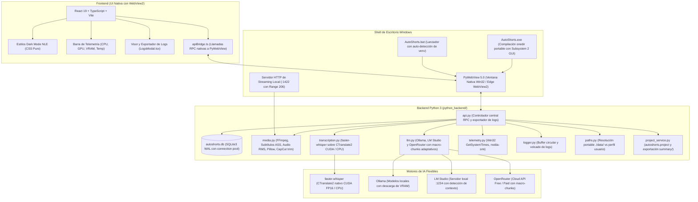

<div align="center">
  
  <h1>AutoShorts</h1>
  <p><strong>Suite de Escritorio Local-First para Extracción, Detección Inteligente y Edición de Clips Verticales Virales</strong></p>

  [](https://github.com/jeffd2599/autoshorts/releases)
  [-blue.svg)](https://github.com/jeffd2599/autoshorts/releases)
  [](https://www.python.org/)
  [](https://react.dev/)
  [](https://www.typescriptlang.org/)
  [](https://vitejs.dev/)
  [](https://pywebview.flowrl.com/)
  [](https://ffmpeg.org/)
  [](https://github.com/SYSTRAN/faster-whisper)
  [](https://pnpm.io/)
  [](https://opensource.org/licenses/MIT)
</div>

---

**AutoShorts** es una suite de escritorio de alto rendimiento especializada en la **extracción, detección inteligente y edición de clips verticales virales (9:16 Shorts, TikToks y Reels)** a partir de grabaciones extensas de directos (Twitch, Kick o YouTube) y podcasts de 1 a 4+ horas.

Diseñada bajo una arquitectura **Local-First**, AutoShorts procesa la transcripción de audio de forma 100% local en tu hardware con **faster-whisper (CTranslate2)** sobre GPU NVIDIA CUDA o CPU. Para la inferencia y análisis de momentos virales, ofrece compatibilidad flexible con **LLMs locales (Ollama y LM Studio)** y con la nube mediante **OpenRouter (modelos Free y Paid)** con optimización avanzada de macro-chunks para no saturar tu cuota diaria.

> [!TIP]
> **Versión Portable Oficial para Windows (Zero-Install):** Para la gran mayoría de usuarios y creadores de contenido, **no es necesario instalar Python, Node.js ni compilar código**. Descarga el archivo [AutoShorts-v2.9.0-windows-x64-portable.zip](https://github.com/jeffd2599/autoshorts/releases) (~180 MB), descomprímelo en cualquier disco o pendrive y ejecuta directamente `AutoShorts.exe`.

> [!NOTE]
> **Privacidad y Cero Consumo de Audio:** Toda la transcripción acústica, detección de voz, cálculo de decibelios RMS y renderizado de video con FFmpeg ocurren en tu equipo. Tu archivo de video jamás se sube a internet.

---

## Indice

- [Arquitectura del Sistema](#arquitectura-del-sistema)
- [Funcionalidades Principales](#funcionalidades-principales)
  - [1. Detección Inteligente de Momentos y Chunks Adaptativos](#1-deteccion-inteligente-de-momentos-y-chunks-adaptativos)
  - [2. Inferencia en la Nube con OpenRouter (Free y Paid)](#2-inferencia-en-la-nube-con-openrouter-free-y-paid)
  - [3. Editor de Cortes Internos Estilo CapCut](#3-editor-de-cortes-internos-estilo-capcut)
  - [4. Estudio de Subtítulos Dinámicos e Insignias CTA](#4-estudio-de-subtitulos-dinamicos-e-insignias-cta)
  - [5. Arquitectura de Proyectos Autónomos (autoshorts.project)](#5-arquitectura-de-proyectos-autonomos-autoshortsproject)
  - [6. Visor y Exportador de Logs del Sistema](#6-visor-y-exportador-de-logs-del-sistema)
  - [7. Social Copywriting Conciso y Antislop UI](#7-social-copywriting-conciso-y-antislop-ui)
  - [8. Telemetría de Hardware en Tiempo Real](#8-telemetria-de-hardware-en-tiempo-real)
- [Descarga y Ejecución Portable](#descarga-y-ejecucion-portable)
- [Requisitos Previos (Para Desarrolladores)](#requisitos-previos-para-desarrolladores)
- [Instalación para Desarrolladores](#instalacion-para-desarrolladores)
- [Modos de Ejecución](#modos-de-ejecucion)
  - [Modo 1: Binario Portable Oficial (AutoShorts.exe)](#modo-1-binario-portable-oficial-autoshortsexe)
  - [Modo 2: Lanzador Rápido (AutoShorts.bat)](#modo-2-lanzador-rapido-autoshortsbat)
  - [Modo 3: Modo Desarrollo con Hot Reload](#modo-3-modo-desarrollo-con-hot-reload)
- [Configuración y Almacenamiento Dual](#configuracion-y-almacenamiento-dual)
- [Estructura del Repositorio](#estructura-del-repositorio)
- [Resolución de Problemas Frecuentes](#resolucion-de-problemas-frecuentes)
- [Créditos y Licencia](#creditos-y-licencia)

---

## Arquitectura del Sistema



---

## Funcionalidades Principales

### 1. Detección Inteligente de Momentos y Chunks Adaptativos

El motor combina el análisis acústico RMS en segundo plano con la comprensión semántica del diálogo:

- **Prompt Fusionado de Alta Retención:** Instruye a la IA bajo directrices editoriales rigurosas:
  - *Ganchos de Alto Impacto:* Frases polémicas, preguntas intrigantes o revelaciones en los primeros 3 segundos.
  - *Picos Emocionales y Gameplay:* Clutches, jugadas épicas, risas contagiosas, gritos, enfados o sustos.
  - *Contenido Narrativo y Humor:* Fails cómicos, anécdotas rápidas, debates intensos o explicaciones condensadas.
- **Detección Acústica en Gameplay Silencioso:** Inyecta etiquetas `[CLUTCH / ACCION ACUSTICA]` analizando decibelios RMS de fondo cuando el jugador se concentra en jugadas tensas sin hablar.
- **Normalización de Duraciones:** Aplica restricción estricta (`clamp_candidate_duration`) para que un clip de 1 minuto jamás se desborde a 3 o 5 minutos.
- **Segmentación Dinámica Adaptativa:** AutoShorts dimensiona automáticamente los bloques según la ventana de contexto (4k, 8k o 16k tokens) y subdivide por bisección ante desbordamiento de contexto (`exceed_context_size_error`).

---

### 2. Inferencia en la Nube con OpenRouter (Free y Paid)

Para usuarios que no cuentan con tarjetas gráficas con suficiente VRAM para correr modelos 7B/14B en local, AutoShorts incorpora integración oficial con **OpenRouter**:

- **Modelos Gratuitos (`openrouter/free`):** Ruteo automático hacia modelos de alto rendimiento como Particle-1, Nemotron 3.5, North Mini Code o Ling 3.2 sin costo alguno ($0.00).
- **Macro-Chunks Adaptativos para Videos Largos:**
  - Grabaciones de hasta 1 hora: bloques de 15 minutos (`900s`).
  - Grabaciones de 1 a 2 horas: bloques de 20 minutos (`1200s`).
  - Grabaciones de más de 2 horas (directos de 125+ min): bloques de 25 minutos (`1500s`).
  - En un directo de 2 horas y 5 minutos, esto reduce las llamadas a la API de **9 a solo 5 peticiones**, preservando el 90% de la cuota diaria de 50 peticiones/día de OpenRouter Free.
- **Rate Limit Guard y Circuit Breaker:** Retraso inteligente de 2.5s entre bloques y circuit breaker inmediato ante HTTP 401 (clave errónea) o 429 (cuota diaria alcanzada), evitando bloqueos y reintentos innecesarios.
- **Saneamiento Automático de Razonamiento (CoT):** Purga etiquetas `<think>...</think>` y extrae respuestas limpias desde `reasoning_content` de modelos DeepSeek R1 o similares.

---

### 3. Editor de Cortes Internos Estilo CapCut

AutoShorts permite refinar el momento detectado antes de mandarlo a exportar:

- **Línea de Tiempo Multi-Segmento:** Botón "Dividir en cabezal" para partir el clip en fragmentos independientes.
- **Descarte de Fragmentos Muertos:** Marca o desmarca fragmentos para eliminar silencios, esperas o pausas dentro del clip.
- **Concatenación Frame-Accurate con FFmpeg:** Fusión transparente de video y audio con remapeo temporal matemático de los subtítulos `.ass` y `.srt`.

---

### 4. Estudio de Subtítulos Dinámicos e Insignias CTA

- **6 Presets Tipográficos Profesionales:** `tiktok-karaoke`, `loud-viral`, `arcade-retro`, `cyber-terminal`, `clean-editorial` y `modern-box`.
- **Control de Posición y Tamaño Interactivo:** Arrastra o ajusta la posición de los subtítulos (Superior, Centro, Inferior) y el tamaño de la tipografía para no tapar interfaces del juego ni botones de redes sociales.
- **Insignias CTA Animadas:** Configuración de botón "Seguir" o "Suscríbete" con escalado vectorial y renderizado quemado en video con FFmpeg.
- **Persistencia en Cortes en Lote:** La exportación individual o en lote recupera automáticamente las coordenadas, estilos y recortes personalizados de cada momento.

---

### 5. Arquitectura de Proyectos Autónomos (`autoshorts.project`)

- **Archivo Descentralizado:** En la raíz de cada carpeta de video se almacena `autoshorts.project`.
- **Cero Re-Transcripciones:** Si trasladas la carpeta a otro equipo o disco, AutoShorts reconoce la transcripción y candidatos al instante sin volver a procesar con Whisper.
- **Re-vinculación Inteligente de Disco:** Si la letra de la unidad cambia (ej. de `D:\` a `E:\`), el software actualiza las rutas relativas de forma transparente.
- **Carpeta `summary/` Automática:** Generación continua de `transcripcion_completa.txt`, `subtitulos_completos.srt` y `momentos_virales.txt`.

---

### 6. Visor y Exportador de Logs del Sistema

- **Consola Integrada:** Visualiza en tiempo real eventos de transcripción, uso de VRAM, peticiones LLM y comandos FFmpeg.
- **Exportación Nativa a Disco:** Botón "Exportar" con diálogo nativo de Windows (`SAVE_DIALOG`), guardado de logs con formato UTF-8 y botón rápido de "Abrir carpeta".
- **Copia al Portapapeles Blindada:** Fallback mediante elemento fuera de pantalla ante pérdidas de foco en WebView2.

---

### 7. Social Copywriting Conciso y Antislop UI

- **Copys Virales Sin Relleno:** Títulos llamativos y descripciones de 2 a 3 líneas sin repetir innecesariamente el titular.
- **Límite Estricto de 3 a 5 Hashtags:** Selección de etiquetas precisas para no saturar las descripciones en smartphone.
- **Diseño Profesional Antislop:** Interfaz limpia estilo suite NLE profesional, sin emojis decorativos no solicitados en métricas ni botones.

---

### 8. Telemetría de Hardware en Tiempo Real

- **CPU %:** Lectura Win32 con `GetSystemTimes` (sin consumo de CPU).
- **GPU y VRAM:** Carga y memoria asignada mediante `nvidia-smi`.
- **Temperatura de GPU (°C):** Monitorización térmica continua durante renderizados de video.

---

## Descarga y Ejecución Portable

1. Descarga el paquete oficial: [AutoShorts-v2.9.0-windows-x64-portable.zip](https://github.com/jeffd2599/autoshorts/releases) (~180 MB).
2. Haz clic derecho y selecciona **Extraer todo...** en la carpeta o disco que desees.
3. Entra a la carpeta `AutoShorts` y ejecuta directamente `AutoShorts.exe`.
4. El programa abrirá una ventana de escritorio pura (con `Subsystem = 2`, sin consolas CMD emergentes).

---

## Requisitos Previos (Para Desarrolladores)

| Componente | Mínimo | Recomendado | Notas |
| :--- | :--- | :--- | :--- |
| **Sistema Operativo** | Windows 10 (64-bit) | Windows 11 (64-bit) | Compatible con Linux y macOS en desarrollo. |
| **Python** | 3.10 | **3.11.x** | Recomendado para CTranslate2 y PyWebView. |
| **Node.js** | 18.x (LTS) | 20.x o superior | Para compilar la interfaz de React. |
| **Gestor de Paquetes** | **pnpm 9+** | **pnpm 9+** | Gestor obligatorio para el frontend. |
| **FFmpeg y FFprobe** | Versión 5.x | **Versión 6.x o 7.x en el PATH** | Indispensable para cortes y subtítulos. |
| **GPU NVIDIA (Opcional)** | CPU Intel / AMD | **GeForce RTX con CUDA** | Aceleración nativa de faster-whisper. |

### Instalación de FFmpeg
- **Windows (PowerShell):** `winget install Gyan.FFmpeg`
- **macOS:** `brew install ffmpeg`
- **Linux (Ubuntu / Debian):** `sudo apt update && sudo apt install -y ffmpeg`

---

## Instalación para Desarrolladores

```bash
# 1. Clonar el repositorio
git clone https://github.com/jeffd2599/autoshorts.git
cd autoshorts

# 2. Crear y activar entorno virtual
python -m venv venv
.\venv\Scripts\Activate.ps1   # En Windows

# 3. Instalar dependencias backend
pip install -r requirements.txt

# 4. Instalar y compilar frontend
pnpm install
pnpm run build
```

---

## Modos de Ejecución

### Modo 1: Binario Portable Oficial (AutoShorts.exe)
Ejecución zero-install autónoma con datos almacenados en `./data/`.

### Modo 2: Lanzador Rápido (AutoShorts.bat)
Lanzador en 1 clic que auto-detecta el entorno virtual (`venv`, `.venv`) y valida dependencias con diagnóstico en caso de error.

### Modo 3: Modo Desarrollo con Hot Reload
```bash
# Terminal 1: Servidor de desarrollo Vite
pnpm run dev

# Terminal 2: Shell de escritorio
AutoShorts.bat
```

---

## Estructura del Repositorio

```text
autoshorts/
├── python_backend/               # Backend en Python 3
│   ├── api.py                    # Controlador RPC principal expuesto a PyWebView
│   ├── db.py                     # Capa de datos en SQLite3 embebido con WAL
│   ├── llm.py                    # Orquestador LLM (Ollama, LM Studio y OpenRouter)
│   ├── llm_prompts.py            # Prompts de retención y generador de copys
│   ├── logger.py                 # Buffer circular de logs y rotación en disco
│   ├── media.py                  # Integración FFmpeg, subtítulos ASS, audio RMS y Pillow
│   ├── paths.py                  # Resolución de rutas portables (./data/ vs %USERPROFILE%)
│   ├── stream_server.py          # Servidor HTTP local con soporte Range 206
│   ├── telemetry.py              # Telemetría de CPU (Win32), GPU, VRAM y temperatura
│   ├── transcription.py          # Pipeline con faster-whisper (CTranslate2 CUDA/CPU)
│   ├── version.py                # Fuente de verdad de versionado semántico (v2.9.0)
│   └── services/                 # Servicios modulares de proyecto y archivos
├── src/                          # Frontend en React 19 + TypeScript
│   ├── components/               # Modales, paneles y componentes de interfaz
│   ├── hooks/                    # Gestión de estado (useMediaPipeline, useAppSettings)
│   ├── styles/                   # Sistema de diseño dark mode NLE en CSS puro
│   ├── types.ts                  # Definiciones de tipos TypeScript
│   └── apiBridge.ts              # Adaptador RPC nativo para PyWebView
├── AutoShorts.bat                # Lanzador de desarrollo con detección de entorno
├── AutoShorts.spec               # Especificación PyInstaller onedir con assets y DLLs CUDA
├── build_portable.py             # Compilador y empaquetador oficial .zip y .tar.gz
├── run.py                        # Punto de entrada principal con freeze_support
├── requirements.txt              # Requisitos de Python (faster-whisper, pywebview, pillow)
├── package.json                  # Scripts y dependencias del frontend (v2.9.0)
├── DECISIONS.md                  # Registro de decisiones de arquitectura
└── README.md                     # Documentación técnica exhaustiva del proyecto
```

---

## Resolución de Problemas Frecuentes

### 1. `ffmpeg` o `ffprobe` no se reconocen como un comando
Verifica que FFmpeg esté instalado y que su subcarpeta `bin` esté en la variable de entorno `PATH`. Comprueba con `ffmpeg -version`.

### 2. Cuota de OpenRouter agotada (HTTP 429)
En modo Free (`openrouter/free`), OpenRouter limita a 50 peticiones por día. Con los macro-chunks adaptativos de AutoShorts v2.9, un directo de 2 horas solo consume 5 peticiones. Si alcanzas el límite de 50 peticiones en un solo día, puedes alternar temporalmente a Ollama / LM Studio local o ingresar créditos en OpenRouter conmutando a modo "Pago".

### 3. faster-whisper no utiliza la tarjeta gráfica NVIDIA
Verifica que tu entorno detecte la GPU ejecutando:
```bash
python -c "import ctranslate2; print('Dispositivos CUDA:', ctranslate2.get_cuda_device_count())"
```
Si devuelve `1` o más, la aceleración CUDA está plenamente activa. En caso contrario, el sistema aplicará fallback elegante a CPU sin detenerse.

---

## Créditos y Licencia

Este software se distribuye bajo los términos de la **Licencia MIT**. Consulta el archivo [LICENSE](LICENSE) para más información.
